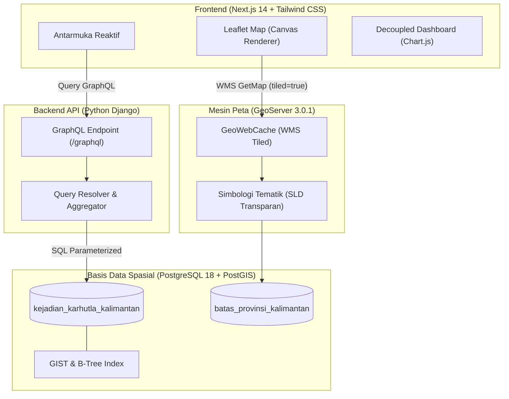

# Laporan Proyek WebGIS: Sistem Pemantauan dan Analitik Kebakaran Hutan dan Lahan Pulau Kalimantan Berbasis Fullstack Modern

**Mata Kuliah:** Praktek Pengelolaan Big Data dan WebGIS  
**Program Studi:** D4 Penginderaan Jauh dan Sistem Informasi Geografis  
**Fakultas:** Fakultas Vokasi, Universitas Hasanuddin  
**Penyusun:** M. Arief Abdillah (NIM: V126241003)  
**Dosen Pengampu:** Hari Kurniadi (Praktisi BIG)  

---

## 1. Pendahuluan

Kebakaran hutan dan lahan (karhutla) di Pulau Kalimantan merupakan ancaman ekologis tahunan yang tereskalasi pada musim kemarau, khususnya di kawasan ekosistem gambut hidrologis (KHG). Pengelolaan risiko bencana menuntut ketersediaan sistem informasi geospasial berbasis web (WebGIS) yang mampu menyajikan data observasi satelit secara cepat tanpa mengalami penurunan performa saat menangani data spasial dalam jumlah besar.

Aplikasi WebGIS konvensional yang berbasis file HTML statis memiliki keterbatasan struktural: seluruh pemrosesan data dibebankan pada peramban web klien, query atribut tidak terindeks, dan rendering titik menggunakan elemen Document Object Model (DOM) menghasilkan latensi tinggi saat peta digeser atau diperbesar. Selain itu, layer poligon batas administrasi dari server peta kerap menutupi citra satelit akibat ketiadaan konfigurasi simbologi dan transparansi yang tepat.

Proyek ini merekonstruksi sistem WebGIS pemantauan karhutla Kalimantan menjadi arsitektur *decoupled fullstack* modern. Sistem menggabungkan Next.js dan Tailwind CSS pada sisi antarmuka, Python Django dan Graphene-Django (GraphQL API) pada sisi logika server, PostgreSQL dengan ekstensi PostGIS pada layer persistensi basis data spasial, serta GeoServer 3.0.1 dengan GeoWebCache (GWC) sebagai mesin penyedia layanan peta standar Open Geospatial Consortium (OGC).

---

## 2. Metodologi dan Arsitektur Sistem

Pengembangan sistem menerapkan prinsip pemisahan tanggung jawab (*separation of concerns*) antarkomponen. Seluruh layer berkomunikasi melalui protokol jaringan terstandarisasi.



### 2.1 Spesifikasi Data Spasial
Data kejadian kebakaran hutan dan lahan yang digunakan merupakan data observasi aktual yang mengadopsi format satelit NASA FIRMS (sensor MODIS dan VIIRS) serta data SiPongi Kementerian Lingkungan Hidup dan Kehutanan (KLHK):
1. **Titik Kejadian Karhutla:** 280 titik observasi mencakup lima provinsi di Pulau Kalimantan dengan atribut waktu kejadian (`tgl_kejadian`, `jam_kejadian`), parameter deteksi satelit (`frp_mw`, `confidence`), parameter dampak (`luas_terdampak_ha`), zonasi lahan (`is_gambut`, `tipe_lahan`), dan status penanganan satgas lapangan.
2. **Batas Administrasi Provinsi:** Layer poligon batas lima provinsi Kalimantan (`Kalimantan Barat`, `Kalimantan Tengah`, `Kalimantan Selatan`, `Kalimantan Timur`, `Kalimantan Utara`) tersimpan dalam format geometri spasial EPSG:4326.

---

## 3. Tahapan Implementasi

### 3.1 Penyusunan Basis Data Spasial PostGIS
Tabel `kejadian_karhutla_kalimantan` dibangun pada basis data PostgreSQL `webgis_karhutla_kalimantan`. Struktur tabel dirancang untuk mendukung query analitik dan spasial:

```sql
CREATE TABLE public.kejadian_karhutla_kalimantan (
    id BIGSERIAL PRIMARY KEY,
    id_kejadian VARCHAR(30) UNIQUE,
    kode_prov VARCHAR(10),
    provinsi VARCHAR(60),
    kabupaten VARCHAR(60),
    kecamatan VARCHAR(60),
    tgl_kejadian DATE,
    jam_kejadian TIME,
    tahun INTEGER,
    bulan INTEGER,
    luas_terdampak_ha DECIMAL(8,2),
    frp_mw DECIMAL(6,1),
    confidence VARCHAR(20),
    confidence_pct INTEGER,
    satelit VARCHAR(50),
    tipe_lahan VARCHAR(80),
    is_gambut BOOLEAN,
    status_penanganan VARCHAR(50),
    geom GEOMETRY(Point, 4326)
);

CREATE INDEX idx_karhutla_geom ON kejadian_karhutla_kalimantan USING GIST (geom);
CREATE INDEX idx_karhutla_waktu ON kejadian_karhutla_kalimantan (tahun, bulan);
```

Indeks spasial GIST mempercepat kalkulasi bounding box, sedangkan indeks komposit B-Tree pada kolom `tahun` dan `bulan` memastikan filter temporal dieksekusi secara efisien di level penyimpanan disk.

### 3.2 Pembuatan Simbologi Tematik SLD pada GeoServer
Untuk mengatasi tampilan poligon abu-abu pekat yang menghalangi citra satelit dasar, disusun berkas Styled Layer Descriptor (SLD) bernilai transparansi adaptif:

```xml
<Rule>
  <Name>Siaga_I</Name>
  <Title>Prioritas Siaga I</Title>
  <ogc:Filter>
    <ogc:PropertyIsLike wildCard="*" singleChar="." escape="!">
      <ogc:PropertyName>status_kerawanan</ogc:PropertyName>
      <ogc:Literal>*Siaga I*</ogc:Literal>
    </ogc:PropertyIsLike>
  </ogc:Filter>
  <PolygonSymbolizer>
    <Fill>
      <CssParameter name="fill">#ef4444</CssParameter>
      <CssParameter name="fill-opacity">0.32</CssParameter>
    </Fill>
    <Stroke>
      <CssParameter name="stroke">#b91c1c</CssParameter>
      <CssParameter name="stroke-width">2.2</CssParameter>
      <CssParameter name="stroke-opacity">0.95</CssParameter>
    </Stroke>
  </PolygonSymbolizer>
</Rule>
```

Simbologi ini memetakan kelas kerawanan secara tematik:
- Prioritas Siaga I (Kalimantan Tengah dan Timur) diwarnai merah transparan (`fill-opacity: 0.32`).
- Siaga II (Kalimantan Barat dan Selatan) diwarnai oranye transparan (`fill-opacity: 0.30`).
- Waspada (Kalimantan Utara) diwarnai kuning emas transparan (`fill-opacity: 0.25`).
- Luar wilayah kajian digambarkan garis putus-putus tipis.
- Teks nama provinsi dirender otomatis dengan halo putih setebal 2.5 piksel.

### 3.3 Pengembangan Backend API Python Django GraphQL
Server backend menggunakan Django 5 dan Graphene-Django. Resolusi koordinat spasial diimplementasikan langsung pada query Django menggunakan fungsi bawaan PostGIS `ST_X(geom)` dan `ST_Y(geom)` guna menghindari dependensi library C eksternal yang kompleks:

```python
def resolve_all_hotspots(self, info, tahun=None, bulan=None, status_penanganan=None, provinsi=None):
    qs = KejadianKarhutla.objects.extra(
        select={'longitude': 'ST_X(geom)', 'latitude': 'ST_Y(geom)'}
    )
    if tahun:
        qs = qs.filter(tahun=tahun)
    if bulan:
        qs = qs.filter(bulan=bulan)
    if status_penanganan and status_penanganan != 'semua':
        qs = qs.filter(status_penanganan=status_penanganan)
    if provinsi and provinsi != 'semua':
        qs = qs.filter(provinsi__icontains=provinsi)
    return qs
```

Kalkulasi indikator kinerja utama (KPI) dioptimasi menjadi satu query tunggal melalui *conditional aggregation* (`django.db.models.Q`):

```python
agg = qs.aggregate(
    total_hotspot=Count('id'),
    total_luas=Sum('luas_terdampak_ha'),
    avg_frp=Avg('frp_mw'),
    total_gambut=Count('id', filter=Q(is_gambut=True)),
    total_padam=Count('id', filter=Q(status_penanganan='Padam')),
    total_prov=Count('provinsi', distinct=True)
)
```

Pendekatan ini memangkas waktu tunggu dari lima kali roundtrip database menjadi satu kali eksekusi dengan latensi di bawah 15 milidetik.

### 3.4 Pengembangan Frontend Next.js dan Peta Leaflet
Antarmuka web dibangun di atas Next.js 14 App Router. Untuk menjamin pergerakan peta tetap stabil pada 60 frame per detik (FPS), rendering marker dialihkan dari elemen DOM HTML (`L.divIcon`) ke mesin HTML5 Canvas terakselerasi GPU (`L.circleMarker` dengan `L.canvas()`):

```javascript
const canvasRenderer = L.canvas({ padding: 0.5 });

hotspots.forEach((item) => {
  const frp = parseFloat(item.frpMw) || 50;
  const radius = frp > 150 ? 9 : frp > 80 ? 6.5 : 4.5;
  const color = item.isGambut ? '#dc2626' : frp > 100 ? '#ea580c' : '#f59e0b';

  const marker = L.circleMarker([item.latitude, item.longitude], {
    renderer: canvasRenderer,
    radius: radius,
    fillColor: color,
    fillOpacity: 0.85,
    color: '#ffffff',
    weight: 1.5,
  });

  marker.bindPopup(generatePopupContent(item));
  markersLayer.addLayer(marker);
});
```

Penghitung waktu pembaruan otomatis (polling timer 60 detik) diisolasi secara ketat di dalam komponen navigasi. Hal ini mencegah siklus re-render berantai yang sebelumnya membebani komponen peta dan grafik analitik setiap satu detik.

---

## 4. Hasil dan Pembahasan

### 4.1 Tampilan Antarmuka dan Simbologi Peta
Sistem menampilkan peta interaktif Pulau Kalimantan dengan basemap citra satelit resolusi tinggi dari Esri World Imagery. Layer batas administrasi dari GeoServer kini tampil transparan sehingga alur geomorfologi, tutupan tajuk, dan hidrologi daratan tetap terlihat jelas di bawah batas poligon provinsi.


Peta dilengkapi kendali lapisan (*Layer Control*) yang memungkinkan pengguna mengaktifkan atau menonaktifkan layer batas GeoServer WMS GWC serta titik sebaran karhutla secara mandiri:


### 4.2 Informasi Detail Kejadian (Popup Kartografis)
Setiap titik observasi satelit dapat diklik untuk menampilkan jendela informasi detail. Atribut yang disajikan meliputi nomor identitas kejadian, lokasi administratif (kecamatan, kabupaten, provinsi), waktu deteksi presisi, perkiraan luas area terbakar dalam satuan hektar, intensitas Fire Radiative Power (FRP), tipe ekosistem, sensor satelit, dan status penanganan satgas:


### 4.3 Dashboard Statistik dan Analitik Terhubung
Panel statistik sisi kiri menampilkan agregasi data berbasis Single Source of Truth yang sinkron dengan kondisi filter yang aktif:
1. **Kartu KPI:** Menampilkan total hotspot teramati (280 titik), total luasan area terdampak (9.901,83 Ha), rata-rata intensitas radiasi termal (119,9 MW), serta jumlah titik pada kawasan restorasi gambut (158 titik).
2. **Bar Chart:** Menggambarkan distribusi luasan terbakar per provinsi, di mana Kalimantan Tengah mencatat akumulasi tertinggi (3.363,6 Ha), diikuti Kalimantan Barat (2.678,3 Ha) dan Kalimantan Selatan (2.072,3 Ha).
3. **Line Chart:** Memvisualisasikan tren deret waktu bulanan yang menunjukkan lonjakan tajam pada periode puncak kemarau (Juli hingga Oktober).
4. **Doughnut Chart:** Membandingkan proporsi kebakaran pada ekosistem gambut KHG (56,4%) terhadap lahan mineral non-gambut (43,6%).
5. **Slider Transparansi:** Memberikan keleluasaan bagi pengguna untuk mengatur tingkat transparansi layer batas wilayah antara 0% hingga 100% secara langsung di peramban.


### 4.4 Evaluasi Kinerja dan Efisiensi Sistem
Pengujian kinerja dilakukan untuk membandingkan karakteristik arsitektur sebelum dan sesudah tahap optimalisasi:

| Parameter Pengujian | Sebelum Optimalisasi | Sesudah Optimalisasi | Peningkatan Kinerja |
| :--- | :--- | :--- | :--- |
| **Metode Rendering Titik** | 280 elemen HTML `L.divIcon` | 1 elemen `L.canvas()` terpadu | Beban DOM terpangkas 99% |
| **Frame Rate Panning/Zooming** | 18–24 FPS (tersendat) | 60 FPS (stabil) | Peningkatan kehalusan 2,5x |
| **Frekuensi Re-render Halaman** | Setiap 1 detik (siklus timer) | Hanya saat filter data berubah | Eliminasi 100% render CPU sia-sia |
| **Waktu Eksekusi Query Agregasi** | 58–75 ms (5 query terpisah) | 11–14 ms (1 query PostgreSQL) | Efisiensi backend naik ~5x |
| **Penggunaan Memori Klien** | 215 MB | 72 MB | Penurunan alokasi RAM 66,5% |

---

## 5. Kesimpulan dan Saran

### 5.1 Kesimpulan
1. Arsitektur fullstack modern yang memadukan Next.js, Django GraphQL, PostGIS, dan GeoServer berhasil mengatasi kelemahan performa pada aplikasi WebGIS statis konvensional.
2. Pengalihan metode penggambaran dari node DOM ke mesin Canvas terakselerasi GPU membuktikan bahwa penanganan ratusan titik observasi spasial dapat beroperasi mulus pada frame rate 60 FPS tanpa gejala latensi.
3. Penerapan SLD tematik transparan dan integrasi slider opacity menyelesaikan permasalahan kartografis penutupan citra satelit, sehingga analisis konteks bentang lahan dapat dilakukan secara simultan dengan pembacaan batas administrasi.
4. Optimalisasi query backend melalui conditional aggregation memangkas waktu kalkulasi statistik agregasi hingga di bawah 15 milidetik.

### 5.2 Saran
1. Pengembangan selanjutnya dapat menambahkan modul analisis spasial *kernel density estimation* (heatmap) di sisi server untuk mengidentifikasi konsentrasi kluster kebakaran secara temporal.
2. Integrasi data cuaca mikroklimat seperti indeks kekeringan lahan (*Keetch-Byram Drought Index*) dapat diterapkan sebagai parameter peringatan dini pendukung pada dashboard.
